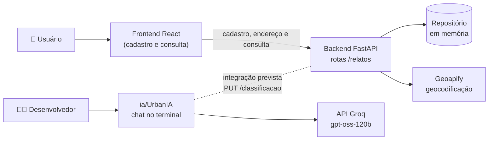
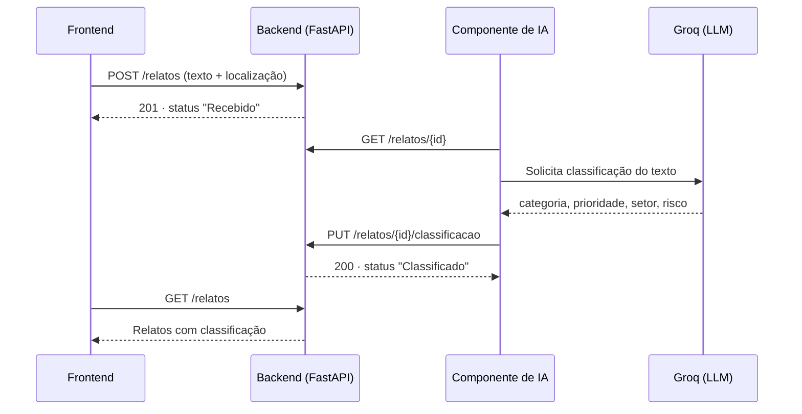
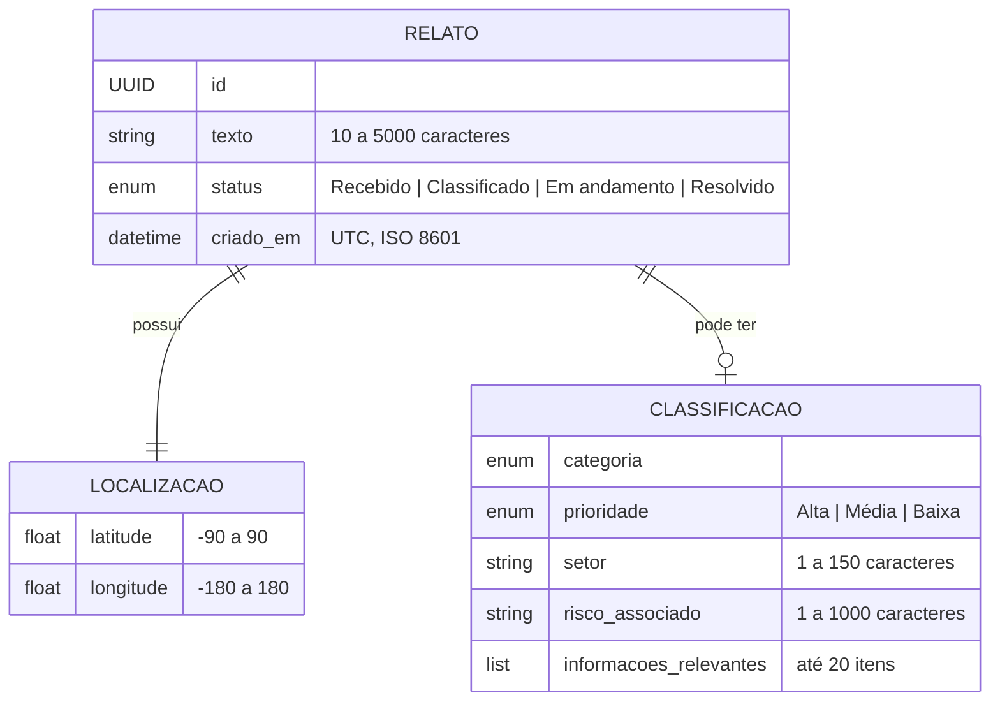
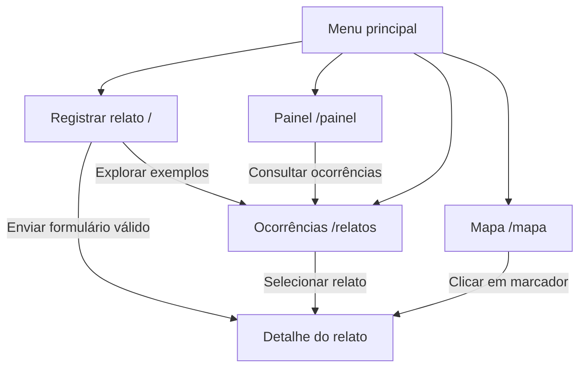

# 🏙️ Radar Urbano IA

### Plataforma inteligente para registro, classificação e priorização de problemas urbanos

> **Viu um problema na sua rua? Conte do seu jeito. A IA organiza, prioriza e indica quem deve resolver.**

O **Radar Urbano IA** é uma plataforma web desenvolvida para o **Projeto Integrador IV da FAESA**. Seu objetivo é facilitar o registro e a organização de problemas urbanos relatados pela população.

A proposta usa **Inteligência Artificial (IA)** e **Modelos de Linguagem (LLMs)** para transformar relatos escritos em linguagem natural em informações estruturadas: **categoria, prioridade, risco associado e setor responsável**.

---

## 🎯 Objetivo

Permitir que cidadãos registrem problemas urbanos de forma simples, descrevendo a situação do seu próprio jeito. A partir do relato, a plataforma deverá:

- 📝 Interpretar o problema informado;
- 🏷️ Classificar a ocorrência;
- ⚠️ Definir um nível de prioridade;
- 📌 Extrair informações relevantes;
- 🏢 Sugerir o setor responsável;
- 📍 Associar a ocorrência à sua localização;
- 🗺️ Organizar as ocorrências em um mapa;
- 📊 Gerar indicadores para acompanhamento.

## 💡 Problema

Ao identificar um problema urbano, o cidadão nem sempre sabe para qual órgão ou setor deve enviar a solicitação, qual é a prioridade da ocorrência, como descrevê-la de forma estruturada ou se outras pessoas já relataram algo semelhante. Além disso, relatos em linguagem natural não seguem um padrão, o que dificulta sua classificação, priorização e encaminhamento.

---

## 🏗️ Arquitetura inicial

O projeto segue uma arquitetura **cliente-servidor em camadas**, dividida em três partes:

| Parte | Pasta | Tecnologia | Situação atual |
|---|---|---|---|
| **Frontend** | `frontend/` | React 19 + Vite + React Router | Telas conectadas à API (cadastro e consulta de relatos) |
| **Backend (API)** | `backend/` | Python + FastAPI + Pydantic | API REST funcional, com **armazenamento em memória** |
| **IA** | `ia/` | Python + API Groq (modelo `openai/gpt-oss-120b`) | Script de chat em terminal, **ainda não integrado** |

> ⚠️ O frontend consome a API para cadastrar e listar relatos. O cadastro localiza endereços com Geoapify; a busca exige `GEOAPIFY_API_KEY` no backend. A IA ainda é independente.

### Diagrama — estado atual



### Fluxo previsto de integração

Conforme `backend/CONTRATO_API.md`, o backend **não chama a IA diretamente**. O componente de IA obtém o relato, classifica-o e envia o resultado para a API:



### Backend (`backend/`)

| Arquivo | Responsabilidade |
|---|---|
| `app/main.py` | Cria a aplicação FastAPI, configura o CORS e define as rotas |
| `app/geocodificacao.py` | Consulta a API Geoapify para converter endereço em coordenadas |
| `app/repositorio.py` | Armazena os relatos em memória (dicionário protegido por `Lock`) |
| `app/schemas/relatos.py` | Modelos `Localizacao`, `RelatoCriar`, `RelatoResposta`, `RelatosLista` e enum `StatusRelato` |
| `app/schemas/classificacao.py` | Modelo `ClassificacaoIA` e enums `Categoria` e `Prioridade` |
| `CONTRATO_API.md` | Contrato detalhado da API e da classificação |

**Rotas disponíveis:**

| Método | Rota | Descrição | Respostas |
|---|---|---|---|
| `GET` | `/` | Verifica se a API está online | 200 |
| `POST` | `/relatos` | Registra um relato | 201, 422 |
| `POST` | `/localizacoes/buscar` | Busca endereço e retorna opções com coordenadas | 200, 422, 503 |
| `GET` | `/relatos` | Lista os relatos em ordem de cadastro | 200 |
| `GET` | `/relatos/{id}` | Busca um relato pelo UUID | 200, 404, 422 |
| `PUT` | `/relatos/{id}/classificacao` | Registra ou substitui a classificação | 200, 404, 422 |

### Modelo de dados



**Categorias:** Infraestrutura, Iluminação, Limpeza Urbana, Trânsito, Segurança e Meio Ambiente.

**Ciclo de status:** o relato é criado como `Recebido` e passa a `Classificado` quando recebe uma classificação. Os status `Em andamento` e `Resolvido` já existem no modelo, mas ainda não há rota para aplicá-los.

### Frontend (`frontend/`)

| Pasta/arquivo | Responsabilidade |
|---|---|
| `src/App.jsx` | Definição das rotas |
| `src/pages/` | Telas da aplicação |
| `src/components/` | Componentes compartilhados (layout, cartões, ícones, selos de prioridade) |
| `src/context/` e `src/hooks/` | Estado dos relatos durante a sessão (`ReportsProvider`, `useReports`) |
| `src/data/` | Categorias e relatos de exemplo |
| `src/utils/` | Funções de formatação e busca |

**Telas:**

| Rota | Tela | Função |
|---|---|---|
| `/` | Registrar relato | Formulário de descrição e endereço; usuário escolhe um resultado geocodificado |
| `/relatos` | Ocorrências | Lista com busca textual e filtros por categoria e prioridade |
| `/relatos/:reportId` | Detalhe do relato | Dados do relato e resultado da análise |
| `/mapa` | Mapa | Esboço ilustrativo com marcadores de exemplo |
| `/painel` | Painel | Indicadores por categoria e prioridade |
| `*` | Página não encontrada | Rota inexistente |



> Os relatos ficam na memória do backend e são removidos quando o servidor reinicia.

### IA (`ia/`)

O arquivo `ia/UrbanIA` contém um script Python de chat no terminal que conversa com o modelo `openai/gpt-oss-120b` pela API Groq (compatível com o SDK da OpenAI) e mantém o histórico da conversa em memória. A chave de acesso é lida da variável de ambiente `GROQ_API_KEY`, carregada de um arquivo `.env`, que não é versionado.

Ainda não estão implementados o prompt de classificação, a saída estruturada e o envio para a API.

---

## 🧰 Tecnologias

| Tecnologia | Finalidade |
|---|---|
| Python, FastAPI, Pydantic, Uvicorn | API REST, validação de dados e servidor |
| pytest, httpx | Testes automatizados da API |
| React, React Router, Vite, ESLint | Interface web, navegação, build e lint |
| Groq API (SDK `openai`/`groq`) | Acesso ao modelo de linguagem |
| Jira | Organização das Sprints |

---

## ▶️ Como executar

### Pré-requisitos

- Python 3 e `pip`
- Node.js e `npm` (frontend validado com Node.js 24.19.0)

### Backend

A partir da pasta `backend`:

```bash
python -m venv venv

# Windows (PowerShell)
.\venv\Scripts\Activate.ps1
# Mac/Linux
source venv/bin/activate

pip install -r requirements.txt
uvicorn app.main:app --reload
```

- API: http://127.0.0.1:8000
- Documentação interativa: http://127.0.0.1:8000/docs

Por padrão, o CORS libera `http://localhost:5173` e `http://127.0.0.1:5173`. Para liberar outras origens, defina a variável `CORS_ORIGINS` com as URLs separadas por vírgula.

Para buscar endereços, defina `GEOAPIFY_API_KEY` no terminal antes de iniciar a API. Mantenha a chave no backend; instruções estão em `backend/CONTRATO_API.md`.

> Os dados ficam em memória e são perdidos sempre que o servidor reinicia.

### Frontend

A partir da pasta `frontend`:

```bash
npm install
npm run dev
```

Outros scripts: `npm run build`, `npm run preview` e `npm run lint`.

### Testes

A partir da raiz do projeto, com o ambiente virtual do backend ativo:

```bash
pip install -r backend/requirements-dev.txt
python -B -m pytest -q
```

Os testes não precisam de banco de dados nem de chave do Groq.

### Script de IA

Crie um arquivo `.env` com `GROQ_API_KEY=<sua chave>` e execute o script com Python. O script também depende do pacote `python-dotenv`, que ainda não está listado no `requirements.txt`.

---

## 📁 Estrutura do repositório

```text
radar-urbano-ia/
├── backend/          → API FastAPI (app/, schemas, contrato, requirements)
├── frontend/         → Interface React + Vite
├── ia/               → Experimentos de integração com o LLM
├── tests/            → Testes automatizados da API
├── docs/             → Documentação e planejamento das Sprints
└── pytest.ini        → Configuração do pytest
```

---

## 🚧 Limitações da versão inicial e próximos passos

- [x] Integrar o frontend com a API (cadastro e listagem de relatos).
- [x] Buscar endereços e confirmar uma opção antes do cadastro (requer `GEOAPIFY_API_KEY`).
- [ ] Implementar a classificação automática dos relatos via IA e o envio para `PUT /relatos/{id}/classificacao`.
- [ ] Implementar a persistência em banco de dados (previsto: PostgreSQL + pgvector).
- [ ] Definir autenticação e controle de acesso à rota de classificação.
- [ ] Implementar a atualização dos status `Em andamento` e `Resolvido`.
- [ ] Substituir o mapa ilustrativo por um mapa real da região do estudo de caso.

O planejamento das Sprints até a entrega da C2 (30/10/2026) está em `docs/Sprints/`.

---

<p align="center"><b>Radar Urbano IA</b> · Projeto Integrador IV · FAESA</p>
